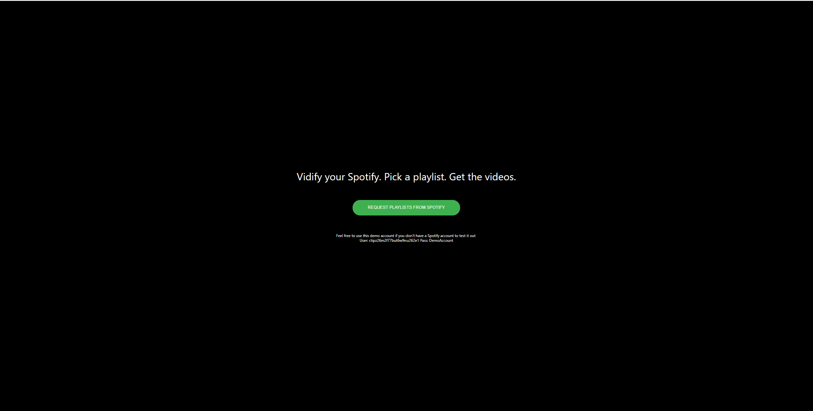
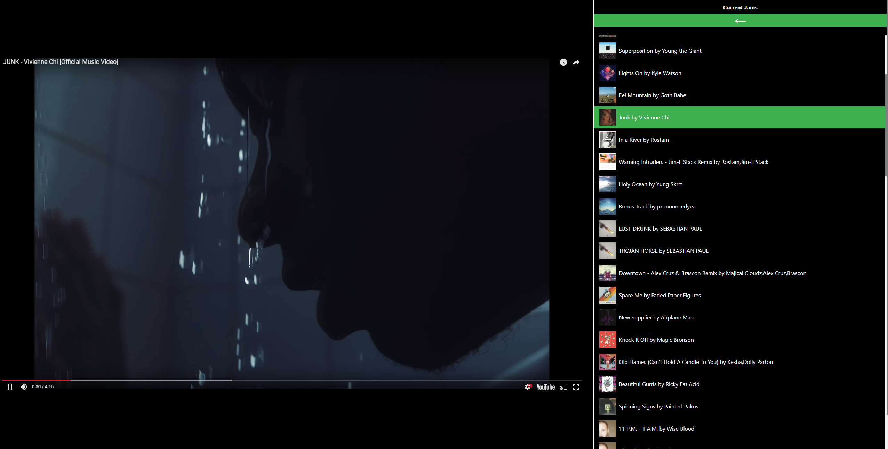

# Personal utility for spinning Spotify playlists into Youtube playlists

👉 https://meljameson.gitlab.io/vidify/

https://gitlab.com/meljameson/vidify/issues

Bootstrapped with CRA. Utilizes Feross's yt-player module for video playback.

🔑 Feel free to use this demo account if you don't have a Spotify account to test it out

User: ctipz26m2f77but6w9nu262e1 Pass: DemoAccount

---
### Log into Spotify

### Choose your playlists and songs
